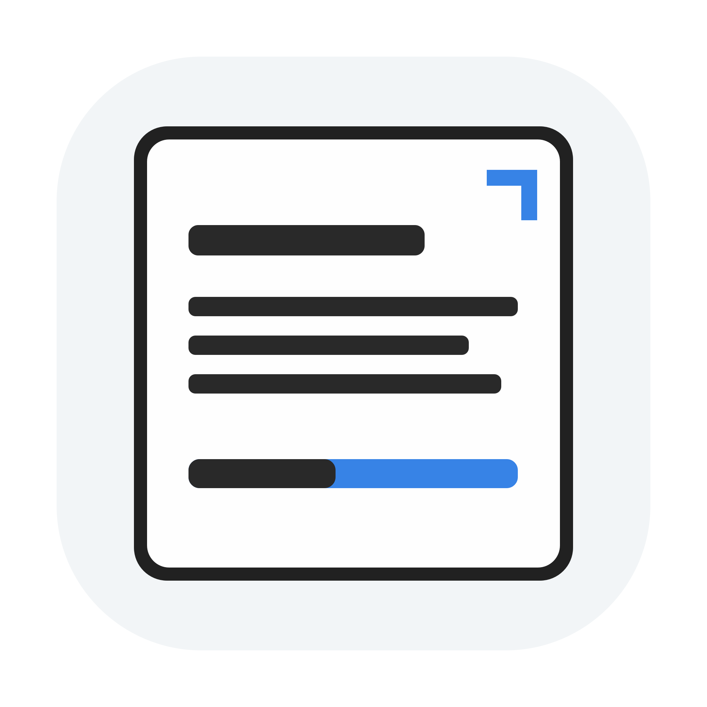
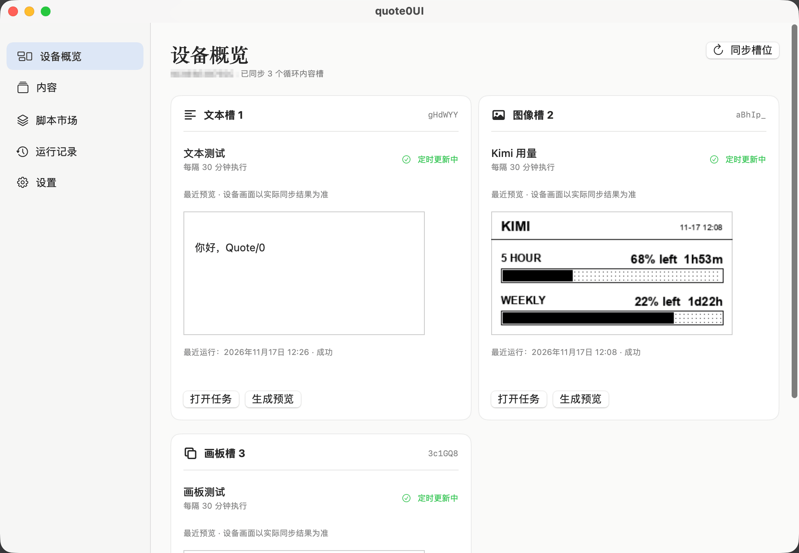

<div align="center">
  
  <h1>quote0UI</h1>
  <p>让 Quote/0 墨水屏自动显示你关心的内容。</p>
  <p>一个运行在 macOS 菜单栏的客户端：安装或编写脚本，配置更新间隔，内容就会定时同步到设备。</p>
  
  <p><sub>设备概览 · Kimi 用量脚本的内容预览</sub></p>
</div>

## 可以做什么

- 支持文本、图像和画板内容槽；可以为每个脚本任务设置运行间隔或每日运行时间。
- 从公开 GitHub 仓库的指定目录浏览、安装和手动更新脚本，也可导入本地脚本目录。
- 脚本通过 `script.json` 声明参数，客户端根据声明生成配置界面。
- 支持设备内容槽同步、设备轮播间隔设置、失败记录筛选和登录后启动。

macOS 睡眠期间不会执行定时任务；设备轮播间隔由设备自身控制。

## 使用

1. 在「设置」中填写 [Dot. 开放 API](https://dot.mindreset.tech/docs/service/open) 密钥并连接 Quote/0 设备。
2. 在「脚本市场」安装脚本，或导入包含 `script.json` 的本地目录。文本、图像和画板演示脚本随应用提供。
3. 点击脚本的「添加到内容」，填写脚本参数，选择同类型的设备内容槽，并启用定时更新。可以先在内容页面测试运行。

官方脚本目录是 [`ScriptCatalog`](ScriptCatalog)。新安装的客户端默认使用该目录；第三方公开目录也可通过类似下面的链接添加：

```text
https://github.com/LinkinStars/quote0-ui/tree/main/ScriptCatalog
```

目录内需要有 `catalog.json`，其中的脚本路径相对于该目录。安装时客户端只下载所选脚本；检查更新不会自动替换本地版本。

## 脚本协议

每个脚本目录至少包含 `script.json` 和可执行的入口文件。例如：

```json
{
  "schemaVersion": 1,
  "id": "example.hello",
  "name": "问候语",
  "version": "1.0.0",
  "description": "显示一段文字",
  "entrypoint": "run.sh",
  "outputType": "text",
  "parameters": [
    { "key": "message", "label": "展示文字", "type": "multiline", "required": true }
  ]
}
```

客户端通过标准输入发送一份 JSON，脚本通过标准输出返回一份 JSON：

```json
{"protocolVersion":1,"parameters":{"message":"你好"}}
```

```json
{"protocolVersion":1,"type":"text","content":{"message":"你好"}}
```

`outputType` 可为 `text`、`image` 或 `canvas`，返回结果的 `type` 必须与之相同。图像和画板输出示例可参考 [`Sources/Quote0UI/Resources/BundledScripts`](Sources/Quote0UI/Resources/BundledScripts)。添加市场脚本时，在目录的 `catalog.json` 中登记其相对路径即可。

脚本以当前 macOS 用户权限执行，能够访问本机文件和客户端传入的配置值。请只安装可信来源的脚本；不要将真实密钥写入脚本或提交到仓库。

## 许可证

[MIT](LICENSE)
